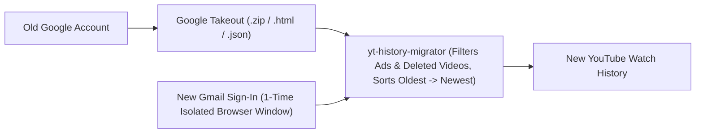

# YouTube Watch History Migrator

A 3-step local Web UI wizard and CLI tool to migrate your Google Takeout YouTube watch history to a new Google / YouTube account cleanly, chronologically (`oldest -> newest`), and fast — without downloading any video files.

## How It Works



YouTube has no native "Import Takeout History" button or public API to write watch history back into a new account. This tool parses your Google Takeout export from your old account, strips ads and deleted videos, sorts everything chronologically (`oldest -> newest`), and replays `"mark as watched"` tracking pings onto your new account using a one-time isolated browser sign-in.

---

## Features

- **3-step local Web UI wizard & CLI**: Guided browser UI at `http://127.0.0.1:8765` plus full CLI subcommands.
- **All Takeout formats**: Parses Google Takeout `.zip` archives directly, `watch-history.html`, and `watch-history.json`.
- **1-click isolated browser sign-in**: Opens an isolated Chrome, Firefox, or Brave window and extracts decrypted cookies natively (including Chrome `v11` App-Bound cookies via DevTools Protocol — no third-party extensions required).
- **Smart filtering & chronological replay (`oldest -> newest`)**: Strips `From Google Ads`, pre-removed/private videos, community `/post/` entries, non-watch activity, and YouTube Music by default; deduplicates to each video's latest watch and replays oldest first so recent videos stay at the top. Optional filters: `--after`, `--before`, `--channel`, `--include-music`, `--exclude-shorts`, and `--include-removed`.
- **Fast ordered prefetch engine**: Uses persistent Keep-Alive InnerTube `/player` JSON requests with bounded parallel prefetch (`Fast` ~0.4s/video, `Turbo` ~0.2s/video, `Safe` ~1.3s/video) while firing watchtime pings strictly in order with automatic `HTTP 429` backoff.
- **Pause & resume anytime**: Flushes every video outcome to `state/progress.jsonl` so interruptions lose zero progress.

---

## Requirements

- **Python 3.11+** (`uv` recommended, or standard `python3 -m venv`)
- **Google Chrome**, **Mozilla Firefox**, or **Brave** installed locally (for the 1-time destination account sign-in)

---

## Step-by-Step Guide: How to Run

### Step 1: Export Your Watch History from Google Takeout

1. Go to [Google Takeout](https://takeout.google.com/) signed into your **old** Google account.
2. Click **Deselect all**.
3. Scroll down to **YouTube and YouTube Music** and check it.
   - _(Optional)_ Click **All YouTube data included**, deselect everything except **history**, and choose JSON or HTML format (both are supported directly, even inside the `.zip`).
4. Click **Next step** -> **Create export**, wait for Google's email, and download the `.zip` archive.

### Step 2: Clone & Install

Pick either **`uv`** (fastest) or standard Python **`venv`**:

```bash
git clone https://github.com/<your-username>/history-youtube-migration.git
cd history-youtube-migration

# Option A: Using uv (recommended)
uv venv .venv
uv pip install --python .venv/bin/python -e ".[dev]"

# Option B: Using standard Python venv
python3 -m venv .venv
./.venv/bin/pip install -e ".[dev]"
```

### Step 3: Launch the 3-Step Web UI Wizard (Recommended)

Start the local server:

```bash
./.venv/bin/yt-migrate ui
```

_(On macOS, you can also double-click `Start UI.command` in Finder.)_

Open **`http://127.0.0.1:8765`** in your browser and follow the 3 steps:

1. **Step 1 — Import Takeout Zip**
   - Drag and drop your Google Takeout `.zip` file (or `watch-history.html` / `watch-history.json`).
   - Pick how much history to import (**Quick 5-Video Test** is selected by default so you can verify first; or pick **2026**, **2024+**, or **Everything**).
   - Click **Next: Sign In to New Gmail ->**.
2. **Step 2 — Sign In to New Gmail**
   - Pick your browser (**Google Chrome**, **Firefox**, or **Brave**) and click **Open Sign-In Window**.
   - Log in with your **NEW Gmail / YouTube account** (and pick the target YouTube channel if prompted).
   - Return to the wizard and click **I've Signed In — Save & Close Window** (or simply close the sign-in window).
   - Click **Next: Start Import ->**.
3. **Step 3 — Import History**
   - Choose an import speed (**Fast** ~0.4s/video, **Turbo** ~0.2s/video, or **Safe** ~1.3s/video) and click **Start Import**.
   - Verify imported videos at `https://www.youtube.com/feed/history` while logged into your new account.
   - You can click **Pause Import** anytime — all completed videos stay saved in `state/progress.jsonl` and resume automatically on the next run.

To stop the server:

- Press `Ctrl+C` in the terminal running `yt-migrate ui`, or run `./.venv/bin/yt-migrate stop` from another terminal.

---

## Alternative: CLI Commands

Prefer running straight from the terminal? Every feature is available via `./.venv/bin/yt-migrate`:

### 1. Inspect Your Takeout Export (Offline Dry Check)

```bash
./.venv/bin/yt-migrate inspect --takeout path/to/takeout.zip
```

### 2. Sign In to Your New YouTube Account

```bash
./.venv/bin/yt-migrate login
```

_(Opens an isolated browser window, waits for you to press `Enter` after signing in, closes the window so cookies don't rotate, and saves `data/cookies.txt`.)_

### 3. Run Migration (`oldest -> newest`, Resumable)

```bash
# Test 5 videos first
./.venv/bin/yt-migrate migrate --takeout path/to/takeout.zip --limit 5

# Import since 2024 using Fast mode (default)
./.venv/bin/yt-migrate migrate --takeout path/to/takeout.zip --after 2024-01-01 --speed fast

# Import everything using Turbo mode (~0.2s/video)
./.venv/bin/yt-migrate migrate --takeout path/to/takeout.zip --speed turbo
```

Useful filtering flags:

- `--after YYYY-MM-DD` / `--before YYYY-MM-DD`: Limit by UTC watch date
- `--include-music`: Include YouTube Music entries (excluded by default)
- `--include-removed`: Include videos that Takeout already shows as deleted/private
- `--exclude-shorts`: Skip `/shorts/` URLs
- `--channel "Channel Name"`: Filter to specific channels (repeatable)
- `--retry-unavailable`: Retry videos previously recorded as unavailable/private

### 4. Check Progress or Export Cleaned URLs

```bash
# Check saved progress counts
./.venv/bin/yt-migrate status --takeout path/to/takeout.zip

# Export deduplicated oldest -> newest URLs & metadata JSON
./.venv/bin/yt-migrate export-urls --takeout path/to/takeout.zip
```

---

## Project Structure & Privacy

```text
.
├── LICENSE                           # GNU Affero General Public License v3.0 (AGPL-3.0)
├── Start UI.command                  # macOS Finder double-click launcher
├── pyproject.toml                    # Package config & yt-migrate entrypoint
├── data/                             # Local Takeout exports & cookies.txt (git-ignored)
├── state/                            # Checkpoint progress.jsonl & auth profiles (git-ignored)
├── output/                           # Cleaned exported URL lists & JSON (git-ignored)
├── src/yt_history_migrator/
│   ├── auth.py                       # Isolated browser sign-in & CDP/Firefox cookie extraction
│   ├── cli.py                        # CLI commands (ui, stop, login, inspect, migrate, status)
│   ├── fast_marker.py                # Fast Keep-Alive InnerTube /player + watchtime marker
│   ├── filter_dedup.py               # Ad/noise filtering & O(N) chronological deduplication
│   ├── importer.py                   # Ordered sliding-window prefetch & yt-dlp fallback runner
│   ├── models.py                     # Typed dataclasses & enums
│   ├── parser.py                     # Takeout .zip, .html, and .json parsers
│   ├── progress_store.py             # Append-only JSONL checkpoint store
│   ├── web_server.py                 # Local 127.0.0.1 HTTP API server
│   └── static/                       # 3-step wizard frontend (HTML, CSS, JS)
└── tests/                            # Pytest suite (mocked HTTP / browser calls)
```

> **Privacy note:** `data/`, `state/`, `output/`, `*.zip`, and `*cookies*.txt` are excluded in `.gitignore` so your personal watch history and Google session cookies are never committed to Git.

---

## Running Tests

```bash
./.venv/bin/pytest -v
```

---

## Disclaimer

This is an unofficial community tool and is not affiliated with Google or YouTube. YouTube stamps replayed watch history entries with the time of import rather than the original historical timestamp, which is why this tool replays your deduplicated history from **oldest to newest** to preserve relative recency.

## License

Licensed under the [GNU Affero General Public License v3.0 (AGPL-3.0)](LICENSE).
